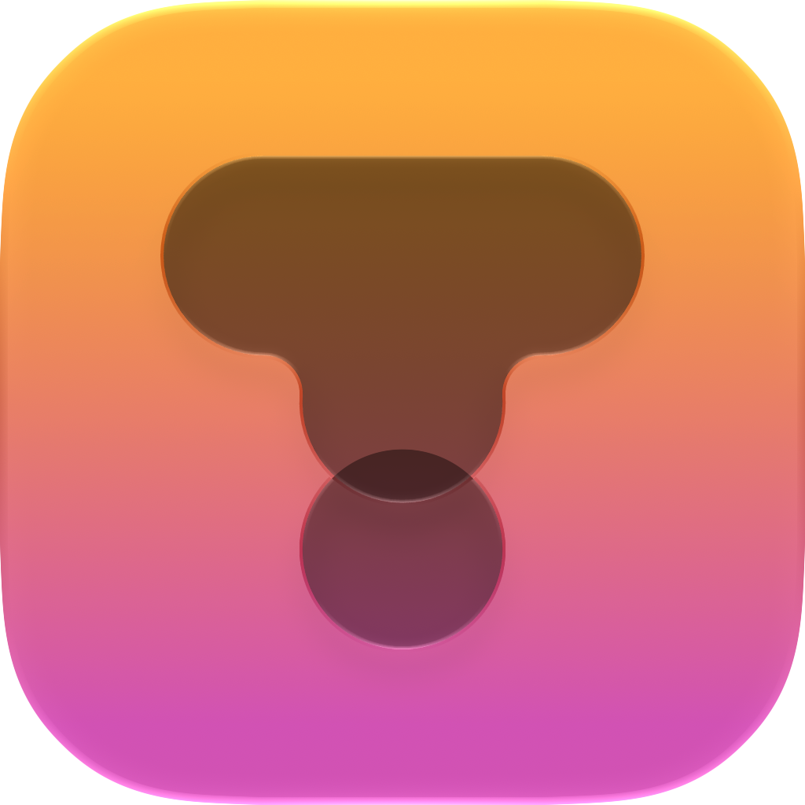

### Tally - Your portable satisfying counter. ###
Made with MAUI
.NET-10
Tested on MacOS 27 Goldengate & iOS 27

## About

Tally is a simple app for counting things, for example push ups, steps or glasses of water.
You can have many counters, each one has its own name and color.
Everything is saved automatically, so after closing the app your counters are still there.

This is my school project for learning .NET MAUI. I designed the look in Figma first and then built it.

## Features

- Add a counter with a name, a start value (can be negative) and a color
- `+` and `−` buttons on every counter
- Reset a counter back to its start value (with confirmation)
- Delete a counter (with confirmation)
- 10 colors to pick from, every counter has light and dark versions of its color
- Autosave after every change, counters are loaded when the app starts
- Adding menu that opens and closes with the `+` button in the top corner
- Haptic feedback on iPhone (small vibration when you tap)
- Different controls on phone and desktop:
  - **iPhone / iPad:** swipe left to delete, swipe right to reset
  - **Mac / Windows:** normal buttons next to the counter

## How to run

You need .NET 10 with the MAUI workload and Xcode (for iPhone and Mac).

Run on Mac:
```
cd CounterApp
dotnet build -t:Build -t:Run -f net10.0-maccatalyst
```

Run on iPhone (connected and unlocked):
```
cd CounterApp
dotnet build -t:Build -t:Run -f net10.0-ios -p:_DeviceName=<your iPhone UDID>
```

You can also just use Rider and press Run.


